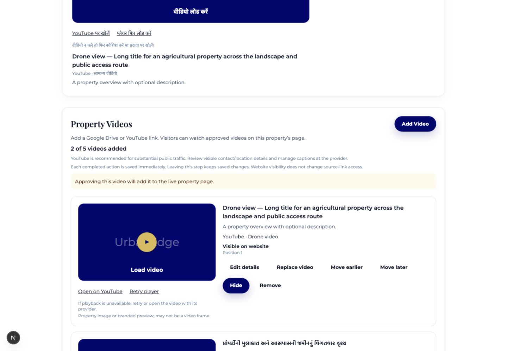
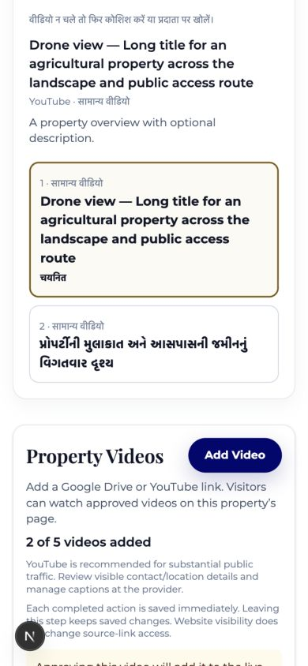

# Property video implementation report

Prepared for the UrbanEdge project on 5 November 2026.

## Outcome and release status

The property-video feature has been implemented in the existing repository. It extends the media registry and property workflow with Google Drive and YouTube video management, controlled publication, staged replacement, posters, and a shared public/admin-preview player.

**The feature is off by default. No live database migration or deployment was performed.** Apply `supabase/migrations/20261104010000_property_videos.sql` to the intended database before enabling `NEXT_PUBLIC_PROPERTY_VIDEOS_ENABLED=true` and rebuilding. The outstanding real-provider and full Supabase checks below remain release gates; the implementation should not yet be described as generally released.

The feature applies by property ID and does not restrict land category. Agricultural, NA, industrial, new, and existing properties use the same workflow. Videos remain optional, and the existing photo and cover requirements for publishing are unchanged.

## Implemented behavior

| Area | Result |
| --- | --- |
| Media step | Renamed to “Photos, Videos & Brochure”; photos, videos, brochure appear in that order. |
| Video creation | Inline form accepts a Drive/YouTube URL, title, standard/drone type, optional description, property photo, or uploaded screenshot. Saving creates a hidden video. |
| Provider guidance | Detected provider instructions appear beside the form. YouTube is recommended for substantial viewing traffic. Admin guidance includes signed-out checks and review of visible contact/location details. |
| Preview | Both providers use their actual embedded player after interaction. Uploaded screenshot previews use a local object URL before saving. A valid URL is never labeled verified playback. |
| Limits | Five active videos per property; archived videos do not count. Titles allow 120 characters and descriptions 500. |
| Management | Edit, preview, replace, move earlier/later, approve, hide, remove/archive, and restore hidden. Archived videos have a separate expandable area. |
| Website state | Hidden, approved for publication on drafts, visible on published properties, and archived states are distinguished. |
| Replacement | A pending replacement is stored separately from the current source. It has its own preview and approval/discard controls. Approval atomically changes the source while retaining the display position. Failed approval retains the original and pending proposal. |
| Public page | Optional Property Videos section after the overview and before detailed facts. One main player plus ordered choices; switching removes the previous iframe and starts from a preview. No player loads on initial page render. |
| Listing preview | Uses an authorized admin query, including approved draft-property videos, and the same video presentation component as the public page. Hidden and archived videos are omitted. |
| Workspace | Video cards, playback, provider/type, titles, and website status are included with existing property media. |
| Global media library | Includes videos, property links, provider/title information, publication-aware status, and type filters. |
| Languages | New video manager/player copy is included in the English, Gujarati, and Hindi dictionaries. Media editor locale follows the existing language cookie. Property titles, descriptions, and speech are not automatically translated. |
| Failure behavior | Provider viewing link and retry remain available. An iframe load event is not treated as evidence of successful playback. Unknown providers fail closed. |
| Feature switch | Disables the new management and rendering without deleting records or changing photo/brochure storage. Changing this public environment setting requires a rebuild. |

Direct video uploads, Google account connections, transcoding, playlists, provider failover, automated thumbnails, and video indicators on search cards remain outside this release, as specified.

## Data and security implementation

The existing `media_assets` table remains the website association and source registry. The migration adds video title, Drive resource key, selected photo/poster references, a pending replacement document, and an integer revision. Existing caption, subtype, provider identity, ordering, approval, visibility, and audit fields are reused.

A separate `property_video_posters` registry records normalized screenshot paths, byte usage, property association, and uploader. Screenshots never become gallery images. Its raw rows are restricted to the service role; the controlled public projection can resolve posters attached to approved public media.

The new `manage_property_video` database function provides the video lifecycle boundary. It requires both a service-role request and an active admin actor, verifies the property and video association, locks operations per property, and rejects stale revisions. It records successful operations in the existing audit log. The trigger also protects video counts, duplicate source identities, revisions, and hidden restoration when older database media functions are used.

Duplicate checks ignore standard/drone labeling and compare provider plus source ID within a property. Reuse between properties is allowed. Pending replacements do not consume additional active-video slots. If another record takes a staged replacement's source identity, approval fails transactionally and retains the existing source.

The migration inventories legacy duplicates and properties with more than five active videos and raises a warning. It does not delete, silently archive, or relabel historical videos. Run `supabase/inspection/property-video-inventory.sql` before rollout and resolve flagged records deliberately. Vimeo playback/editing and Matterport compatibility remain supported; new video entry focuses on Drive and YouTube.

The public projection exposes video presentation metadata and canonical source information. It does not expose pending replacements, internal uploader identifiers, checksums, private documents, or storage administration fields. Its existing published-property, approved-media, non-archived, non-deleted filters remain in effect.

The generated TypeScript schema declarations were updated alongside the migration. Regenerate them from the migrated Supabase instance during deployment validation to check them against the actual database.

## URL and player boundary

A shared client/server parser accepts common YouTube watch, short, Shorts, and single-video embed URLs, plus Drive file view/preview, account-prefixed file links, and `open?id=` links. It extracts the identity, preserves a supported Drive `resourcekey`, and creates controlled viewing/embedding URLs. Tracking, timestamps, playlists, and autoplay parameters are discarded.

Unsupported/deceptive hosts, credential-bearing URLs, unsafe schemes, malformed IDs, folder/channel/playlist-only URLs, arbitrary player paths, and pasted iframe HTML are rejected. The shared player uses explicit provider branches and retains Vimeo/Matterport compatibility.

Drive uses `/preview` in the iframe, rather than a brochure-download or pretend MP4 URL. YouTube uses the privacy-enhanced embedding host. Existing production CSP already permits the required frame origins, so the security policy did not need broadening. The player permits fullscreen and picture-in-picture, has an external viewing link, and does not attempt to diagnose every cross-origin provider failure.

Implementation references: [Google Drive resource keys](https://developers.google.com/workspace/drive/api/guides/resource-keys), [YouTube embedding parameters and player sizing](https://developers.google.com/youtube/player_parameters).

## Posters and storage

Poster priority is uploaded screenshot, selected available property photo, property cover, then branded placeholder. Public selected-photo posters must still be approved public photos from the same property. Archiving a selected photo causes safe fallback and does not block later video lifecycle actions. A failed image request falls back to the brand placeholder.

Screenshot uploads reuse controlled Sharp processing with poster-specific dimensions: JPEG/PNG/WebP decoding, declared/content MIME agreement, source byte/dimension/pixel checks, orientation normalization, WebP compression, maximum output dimensions of 1280 pixels, and metadata removal. Poster screenshots can be smaller than gallery photos; gallery image requirements retain their original defaults.

Only screenshot bytes enter Storage. External video bytes do not enter Supabase Storage or database records. If the transactional registration fails after a screenshot upload, the service checks the poster registry before cleanup. Unregistered objects are removed when the registry confirms they were not committed. A lost RPC acknowledgement cannot cause deletion of a committed poster. If the database cannot answer the reconciliation check, cleanup is deferred; reconcile Storage objects against the registry once access returns.

Storage reporting includes **all retained poster registry bytes**, including screenshots left behind after replacement, removal, or discarded proposals. This deliberately avoids untracked storage and destructive cleanup during rollback. A future cleanup job should delete only posters unreferenced by both current and pending records, then remove the matching registry row after successful object deletion. No automatic purge is included.

Posters are public marketing images in the existing public media bucket. Hiding a video removes the website association from public responses; it does not revoke a known public poster URL or the provider's independent source URL.

## Effects on existing behavior and how they were handled

| Affected behavior | Handling |
| --- | --- |
| Photo upload, cover selection, brochure connection | Existing flows retained; video management is inserted between photos and brochure. Screenshot processing uses an opt-in option so gallery sizing rules are unchanged. |
| Photo/full-collection ordering | Video movement preserves photo/brochure slots. The existing reorder function now takes the property lock and rejects stale video sequences supplied through the photo workflow. Legacy tied positions are normalized when necessary without changing photo sequence. |
| Older media actions | Photo/brochure actions verify the target's property association and reject video targets, preventing a browser action from bypassing video revisions. The old generic add action directs videos to the new manager while retaining 360-tour handling. |
| Cached property detail | Media and publication actions use immediate tag expiry. The property cache key also separates video-enabled and video-disabled builds. Fresh requests wait for current data instead of knowingly receiving stale hidden media. |
| Unpublishing | Property publication actions also expire the public property cache immediately; the public database view excludes videos on unpublished properties. Already loaded browsers/players cannot be remotely retracted. |
| Property publication | No video requirement was introduced. Existing image/cover and other readiness checks remain the publication gate. |
| Navigation during saving | Video pending state participates in the media step's navigation guard. Labels now say Return to Workspace; guidance says saved changes persist when leaving. |
| Security headers | Existing provider frame allowlist is sufficient; no broad frame or script-source exception was added. |
| Existing records | Additive columns, legacy nullable title compatibility, no destructive schema reversal, preflight inventory, and retained legacy players. |
| Site-wide styling | New CSS is scoped to video components and uses existing navy/gold tokens, typography, cards, and buttons. |

## Validation performed

The final command results are recorded below after verification. The isolated database script is reproducible and never connects to a live application database.

- Repository checks: ESLint with zero warnings, formatting, TypeScript, server/client boundaries, secret scan, unit tests, component tests, production build, and built client secret scan.
- Database checks: the exact new migration executes in an isolated PGlite PostgreSQL runtime with representative pre-existing schema, roles, projection RLS, and the repository's actual locator/public-approval constraints.
- Database lifecycle assertions cover hidden creation without stored video bytes, draft/public approval, cross-property denial, stale revisions, duplicates across subtypes, replacement failure/staging/approval/conflict rollback, hiding, hidden restoration, five-video limits, mixed ordering, unpublishing, inactive actors, service-role checks, Drive resource keys, poster projection/accounting, archived-photo fallback, anonymous access denial, and audit creation.
- Service/unit checks cover URL variants and deceptive inputs, disabled-feature behavior, authorization before privileged access, association checks before screenshot work, canonical payloads, failed-save object cleanup, public DTO privacy, and poster resizing/metadata removal.
- Component checks cover no empty section, loading only after interaction, replacing the prior iframe, retry, fullscreen attributes, external fallback links, unknown providers, broken posters, localized controls, and retaining form values after errors.
- Browser fixture checks used the actual components and application styles at **390 × 844**, **768 × 1024**, and **1440 × 1000**. Long titles, Gujarati/Hindi copy, missing posters, form errors, mobile stacking, desktop side-by-side choices, 44-pixel admin button targets, and minimum player height were checked. No component horizontal overflow remained.

A mobile frame sizing issue was found during browser inspection: a minimum height plus an unconstrained aspect ratio could expand width. Setting an explicit frame width fixed the overflow while retaining enough height for controls. A database CASE-expression syntax issue was found by executing the migration and corrected before the lifecycle tests passed.

The temporary fixture page was removed and the preview server stopped after inspection. Screenshots below are from controlled fixtures, not from a live listing or evidence of real provider playback.





### Reproducing the isolated database check

```sh
npm install --prefix /tmp/urbanedge-video-db-test --no-package-lock --no-audit --no-fund @electric-sql/pglite
PROPERTY_VIDEO_DB_RUNTIME=/tmp/urbanedge-video-db-test npm run test:video-db
```

The runtime is intentionally installed outside the application dependencies. This test is a SQL/lifecycle check against a representative fixture, **not** a substitute for the project's full Supabase integration suite or multi-session PostgreSQL concurrency testing. Its simultaneous requests are queued by the isolated runtime.

## Verification still required before release

1. **Full Supabase stack:** apply the migration on a disposable Supabase environment, regenerate types, run `npm run test:db`, `npm run test:integration:local`, and `npm run test:e2e:local`. Docker was unavailable on this machine, so those full-stack suites could not run here. The existing end-to-end tests were updated for the new navigation labels, but were not executed.
2. **True concurrent sessions:** exercise simultaneous additions/restores, duplicate submissions, photo/video ordering, and replacement approvals using separate database sessions. The database implementation takes property locks, but the isolated runtime does not prove production multi-session behavior.
3. **Real signed-out playback:** test organization-owned Drive and YouTube videos using production-like headers on desktop Chrome, Android Chrome, and iPhone Safari. Include a restricted Drive file, a processing video, a resource-key link, a deleted video, and a YouTube video with embedding disabled. No suitable real fixture collection or physical mobile devices was available during implementation.
4. **Real browser accessibility/playback:** verify keyboard operation within the provider's iframe, fullscreen, portrait footage, captions, privacy/cookie behavior, and provider error containment on those target browsers. The website's own controls and sizing were checked; synthetic sources do not prove successful provider playback.
5. **Live inventory and pilot:** run the read-only preflight, resolve existing duplicate/over-limit rows, test existing listings in all three categories, confirm poster usage with actual Storage objects, and inspect a small approved-property pilot while signed out.
6. **Editorial/account ownership:** assign organization-controlled source accounts, retain originals, review visible contact/location information, check captions with the provider, and have fluent reviewers confirm Gujarati/Hindi wording before general release.

## Rollout, ownership, and rollback

1. Run `supabase/inspection/property-video-inventory.sql` on the intended database and review all results.
2. Apply `supabase/migrations/20261104010000_property_videos.sql` before enabling the feature. Preserve existing media records.
3. Complete the Supabase, device/provider, concurrency, and pilot checks above.
4. Set `NEXT_PUBLIC_PROPERTY_VIDEOS_ENABLED=true` in the intended deployment environment and rebuild/deploy. Confirm admin manager visibility, approve/hide behavior on fresh requests, and the absence of video requirements from publication readiness.
5. For rollback, set the flag to `false` and rebuild/deploy. Keep the additive schema, source links, pending replacements, and poster registry. Do not immediately drop columns or delete external files.

Use the media registry as the source manifest. An authorized administrator can export `property_id`, `id`, `external_provider`, `external_media_id`, `external_url`, `drive_resource_key`, `video_title`, `caption`, `media_subtype`, `video_photo_id`, `video_poster_id`, `sort_order`, `visibility`, `approved_at`, and `archived_at`, together with the poster registry. Protect this export because hidden/unlisted source links may still grant provider access.

Before changing providers or a storage benefit expires, inventory and verify originals, size the destination for storage and viewing bandwidth, implement its playback path, validate copied files, and switch references in controlled batches. Presentation metadata and property associations are already separate from provider identity to support that future work. Direct Supabase video hosting is not implemented by this change.

## Final check results

| Check | Final result |
| --- | --- |
| `npm run qa` | Passed in full. |
| ESLint / formatting / TypeScript | Passed; zero lint warnings. |
| Server boundaries / source secret scan | Passed. |
| Unit tests | **270 passed** across 36 files. |
| Component tests | **118 passed** across 22 files. |
| Production build / built client secret scan | Passed. |
| Isolated database workflow | **25 assertions passed**, including the exact migration, existing locator/approval constraints, ordering, and RLS checks described above. |
| Responsive fixture checks | Passed at 390, 768, and 1440 pixel widths; screenshots retained. |
| Full Supabase integration / database suite / end-to-end suite | Not run: local Docker/Supabase stack unavailable. |
| Real provider and target-device playback | Not completed; remains a release gate. |
| Live database / deployment | Unchanged; feature defaults to disabled. |

The initial sandbox-only build could not fetch the project's existing Google Fonts. Re-running with network access completed successfully. No application font behavior was changed to work around that environment restriction.

## Main implementation files

- `lib/media/property-video.ts`: shared parsing, canonical URLs, explicit playback generation, feature flag.
- `components/admin/property-video-manager.tsx`: inline video editor, lifecycle cards, pending replacements, archive restoration.
- `components/media/property-videos.tsx`: shared click-to-load player and collection.
- `components/admin/property-media-manager.tsx`: media-step placement and navigation pending state.
- `components/admin/property-workspace.tsx`: workspace video cards and labels.
- `app/(admin)/admin/(protected)/media/page.tsx`: global library filtering/status.
- `app/(admin)/admin/(protected)/properties/[id]/media/`: media-page integration and authenticated actions.
- `app/(admin)/admin/(protected)/properties/[id]/preview/page.tsx`: authorized draft video projection and shared presentation.
- `app/(public)/properties/[property-slug]/page.tsx`: public placement after overview.
- `server/services/property-media.ts`: validation, normalized poster uploads, lifecycle RPC, source-association checks, and cleanup reconciliation.
- `server/queries/public-properties.ts`, `server/queries/public-page-data.ts`, and `features/properties/queries/public-property-projector.ts`: explicit safe metadata selection, projection, and cache separation.
- `server/storage/image-processing.ts`: poster-specific normalization without changing gallery defaults.
- `lib/i18n/dictionaries.ts` and `app/globals.css`: localized interface copy and scoped styling.
- `supabase/migrations/20261104010000_property_videos.sql`: additive schema, registry, lifecycle function, trigger, ordering protection, usage accounting, and public view.
- `supabase/inspection/property-video-inventory.sql`: read-only rollout preflight.
- `scripts/test-property-video-db.mjs`: isolated migration/lifecycle verification; `package.json` exposes `test:video-db`.
- `tests/unit/property-video*.test.ts`, `tests/component/property-videos.test.tsx`, plus poster/projection regression tests: new automated coverage. Existing workflow component/end-to-end assertions were updated for renamed navigation.
- `.env.example`: rollout flag and migration prerequisite. Type declarations were extended in `types/database.generated.ts`, `types/database.ts`, and the media/property contracts.

## Follow-up and production migration status

The video implementation is present as unstaged local changes on main at a1ae2e8. The GitHub main branch did not have the video module when checked. The follow-up fixed loss of unsaved video edits during navigation, poster preview recovery after a broken image, and precedence for a new screenshot when the previous screenshot was marked for removal.

The focused follow-up passed 37 tests, TypeScript, and lint for the changed components and test scripts. The migration passed 26 isolated database assertions, including with the transaction wrapper prepared for production. The full Supabase, browser, and provider playback suites were not run for this follow-up. No claim is made about actual playback of the supplied YouTube fixture.

The production project configured by this checkout is xrqulhapgjqgymrfuclo. The connected account could list projects but could not see this project or inspect its SQL or migration history. Local browser access was disabled in Work settings. The read-only query in `supabase/inspection/property-video-production-preflight.sql` is ready for the account that has access. Verify production migration history before applying only the pending video migration. The transaction wrapper was prepared at `/tmp/urbanedge-video-production-apply.sql` with existing public-row verification. No production write was attempted or confirmed. No staging, commit, push, merge, pull request, website deployment, or production environment change was performed.

The owner reported applying the production migration and authorized proceeding with the GitHub branch. The production migration-history entry was not independently verified because the connected account lacked access. No production SQL was executed by Codex.


## Add and edit form follow-up

Add Property accepts an optional YouTube or Google Drive URL and video title before the first save. The draft saves first and the video is attached as hidden. If the attachment fails, the media page identifies that the draft was saved and lets the admin retry. Edit Property opens the video form for properties without active videos and offers Add Video for properties that already have them.

Videos now default to enabled when the build setting is absent. Set `NEXT_PUBLIC_PROPERTY_VIDEOS_ENABLED=false` and rebuild to opt out. An existing explicit false still disables the controls. Apply the video migrations for video management. Public property details fall back to the existing media fields if the video projection columns are missing.
